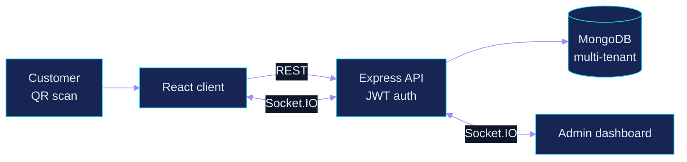
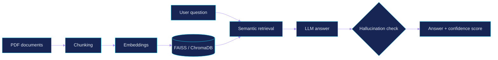
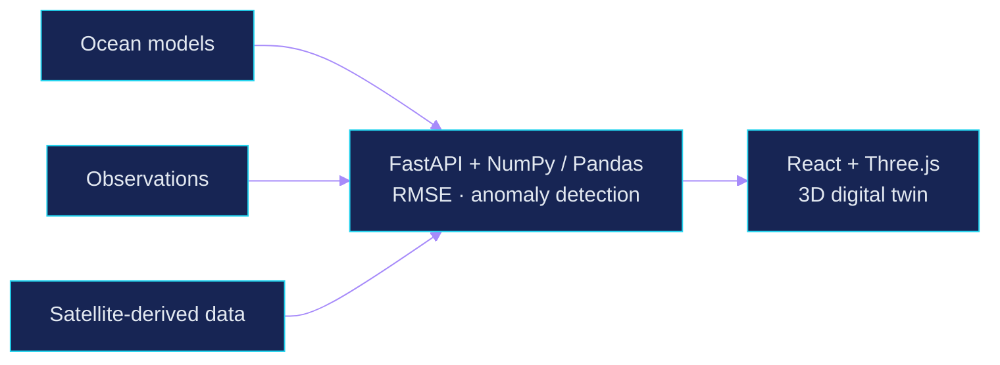
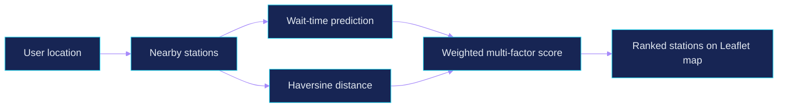

<!--
  VIVEK NIGAM | GitHub Profile README
-->

<div align="center">


<br/>

<a href="https://github.com/vivek28n"></a>
<a href="https://www.linkedin.com/in/vivek-nigam-28n/"></a>
<a href="mailto:nigamvivek2805@gmail.com"></a>

<br/><br/>


<br/><br/>

<sub><a href="#about">ABOUT</a> &nbsp;·&nbsp; <a href="#projects">PROJECTS</a> &nbsp;·&nbsp; <a href="#tech-stack">STACK</a> &nbsp;·&nbsp; <a href="#now">NOW</a> &nbsp;·&nbsp; <a href="#contact">CONTACT</a></sub>

</div>

---

## About

```yaml
name: Vivek Nigam
role: B.Tech CSE (Artificial Intelligence) Student
building: [RAG systems, real-time apps, digital twins, ML-powered products]
languages: [Java, Python, JavaScript, TypeScript]
objective: Engineer reliable, production-ready software that solves real problems
philosophy: "Understand deeply. Build intelligently. Ship consistently."
```

I work across the stack, from interactive 3D interfaces and real-time backends to retrieval pipelines and ML models. I care less about collecting technologies and more about understanding how they fit together into a product people can actually use.

---

## Projects

<sub>FOUR SELECTED BUILDS · EACH ONE EXPANDS TO ITS SYSTEM ARCHITECTURE</sub>

<br/>

### &nbsp; QueueLess

> **Real-time queue management.** Contactless check-in and live position tracking, no app install.

<a href="https://queue-less-nine.vercel.app"></a>
<a href="https://github.com/vivek28n/QueueLess"></a>

- ⚡ Live token position and status updates over **Socket.IO**
- 🔗 QR-based queue joining for guests
- 🏢 Multi-tenant business accounts with **JWT** auth and an admin dashboard
- 🔒 Atomic token generation to handle concurrent requests

`React 19` `Vite` `Tailwind` `Node.js` `Express` `MongoDB` `Socket.IO` `Three.js`

<details>
<summary><b>▸ View system architecture</b></summary>



</details>

<br/>

### &nbsp; Medical RAG &nbsp;

> **Hallucination detection and reliable retrieval.** Making AI answers more grounded in medical document workflows. Research paper in progress.

<a href="https://github.com/vivek28n/Medical-RAG-Hallucination-Detection"></a>

- 📄 PDF ingestion, chunking, and embedding generation
- 🔎 Semantic retrieval through vector databases
- 🎯 Hallucination detection with confidence scoring
- ⚙️ FastAPI backend + React frontend

`Python` `FastAPI` `LangChain` `FAISS / ChromaDB` `React`

<details>
<summary><b>▸ View system architecture</b></summary>



</details>

<br/>

### &nbsp; Ocean3D

> **Interactive ocean digital twin.** Explore ocean conditions across regions, depths, and time.

<a href="https://ocean3d.vercel.app"></a>
<a href="https://github.com/vivek28n/Ocean3d"></a>

- 🌐 WebGL 3D ocean visualization with multiple regions and depths
- 📊 Model vs. observation comparison, RMSE analysis, anomaly detection
- 🧭 Ocean current-flow visualization
- 🤖 Simulated research AUV and glider layer

`React` `TypeScript` `Three.js` `FastAPI` `Python` `NumPy` `Pandas`

<details>
<summary><b>▸ View system architecture</b></summary>



</details>

<br/>

### &nbsp; Smart EV Charging

> **Find the right charging station, not just the nearest one.** Stations ranked on multiple factors instead of distance alone.

<a href="https://github.com/vivek28n/Smart-EV-charging-managment-system"></a>

- 🤖 AI-based waiting-time prediction
- ⚖️ Weighted multi-factor station ranking
- 📍 Haversine distance calculation
- 🗺️ Interactive Leaflet maps with lazy loading

`React` `TypeScript` `Tailwind` `Node.js` `Supabase` `PostgreSQL`

<details>
<summary><b>▸ View system architecture</b></summary>



</details>

---

## Tech Stack

<div align="center">

<sub>LANGUAGES</sub><br/>


<sub>AI / MACHINE LEARNING</sub><br/>


<sub>FRONTEND</sub><br/>


<sub>BACKEND</sub><br/>


<sub>DATABASES & CLOUD</sub><br/>


<sub>TOOLS</sub><br/>


</div>

---

## Problem Solving

<div align="center">

<a href="https://leetcode.com/u/vivek28n/">
  
</a>

<br/><br/>

<a href="https://leetcode.com/u/vivek28n/"></a>
<a href="https://codolio.com/profile/Vivek28"></a>

<sub>DSA · PROBLEM SOLVING IN JAVA</sub>

</div>

---

## GitHub Stats

<div align="center">

<a href="https://github.com/vivek28n">

</a>
<a href="https://github.com/vivek28n">

</a>

<a href="https://github.com/vivek28n">

</a>
<a href="https://github.com/vivek28n">

</a>

<br/>


<br/><br/>


</div>

---

## Now

<div align="center">

| | CURRENT FOCUS |
|:---:|:---|
| `01` | Java + Data Structures & Algorithms |
| `02` | RAG evaluation and hallucination reduction |
| `03` | Generative AI and LLM applications |
| `04` | Backend architecture and scalable systems |
| `05` | Production deployment and engineering practices |

</div>

> **Mindset:** move beyond tutorials, understand the underlying system, then build, test, evaluate, and improve.

---

## Contact

<div align="center">

**Got an interesting idea, an engineering problem, or a collaboration in mind?**
Open to conversations around AI/ML, GenAI, RAG systems, and full-stack engineering.

<br/>

<a href="https://www.linkedin.com/in/vivek-nigam-28n/"></a>
<a href="mailto:nigamvivek2805@gmail.com"></a>

<br/><br/>


<br/><br/>


<sub>ENGINEERED WITH CURIOSITY · POWERED BY CONSISTENCY</sub>

</div>
